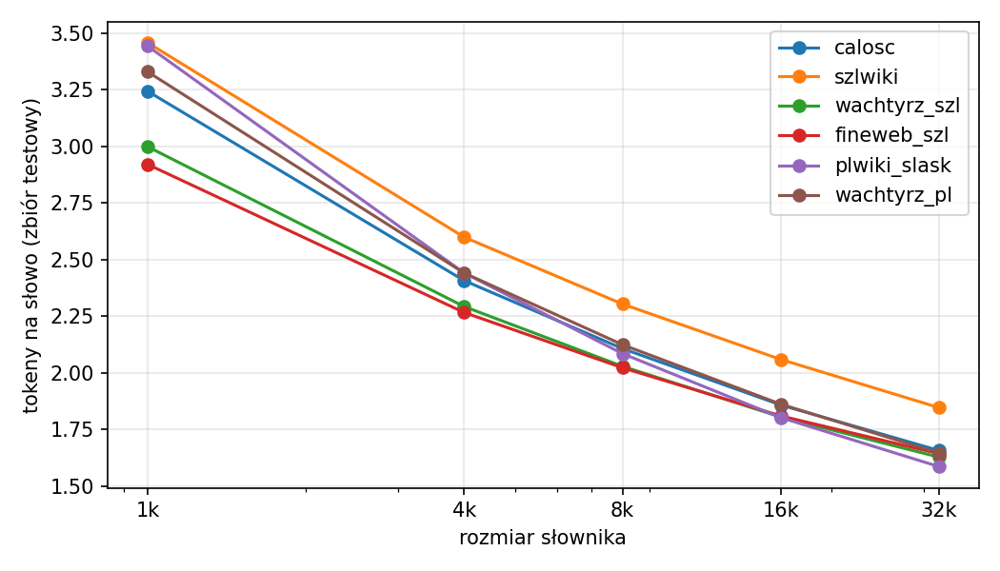
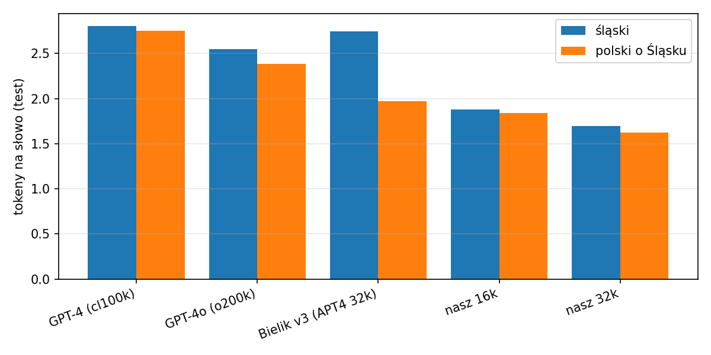
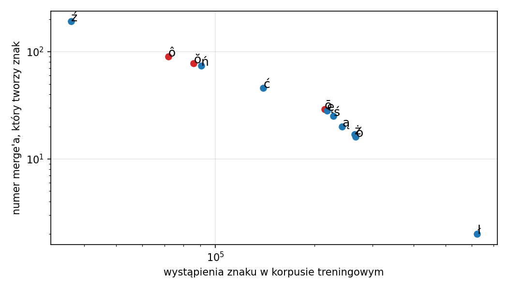

# Tokenizer BPE dla gŏdki — raport

Praca domowa do lekcji 02 („Tokenizacja i BPE od zera”), kurs 01 Fabryka. Kod: to repo, `python run_all.py`.

## Kilka słów wyjaśnienia

- **Token**: kawałek tekstu, na którym pracuje model: całe słowo, jego część albo pojedynczy znak.
  Więcej tokenów na ten sam tekst = drożej i mniej tekstu mieści się w modelu naraz.
- **Tokenizer**: program, który tnie tekst na tokeny. **Słownik** to lista wszystkich tokenów, które zna.
- **BPE**: sposób budowania słownika. Startuje od 256 bajtów i w kółko skleja parę, która najczęściej
  stoi obok siebie, np. „g”+„ŏ” → „gŏ”, potem „gŏ”+„d” → „gŏd”. Każde sklejenie (merge) to jeden nowy token.
- **Tokeny na słowo** (fertility): ile tokenów średnio przypada na jedno słowo. Im mniej, tym lepiej.
- **Zbiór testowy**: 10% tekstów odłożonych przed treningiem. Wszystkie pomiary są na nim, bo mierzenie
  na tekście, na którym tokenizer się uczył, zawyża wyniki.
- **Gŏdka** to język śląski. **Ślabikŏrz** to najpopularniejsza pisownia, z literami ō, ŏ, ô.
  W UTF-8 każda z nich (tak jak ą czy ż) zajmuje 2 bajty, które BPE musi najpierw skleić.

## 1. Korpus

**Dziedzina:** „Górny Śląsk: gŏdka i kultura”, czyli teksty po śląsku i polskie teksty o Górnym Śląsku.
Świadomie wąska, regionalna dziedzina, a nie „ogólny polski”.

| Źródło | Język | Po czyszczeniu | Licencja |
|---|---|---|---|
| Ślōnsko Wikipedyjo (zrzut 2026-11-01) | śląski | 6,7 MB | CC BY-SA |
| Wachtyrz.eu, akapity śląskie | śląski | 6,7 MB | **[uzupełnij: link do licencji / zgoda redakcji]** |
| FineWeb-2 `szl_Latn` | śląski (różne pisownie i gwary) | 11,8 MB | ODC-By |
| Polska Wikipedia, kategorie o Górnym Śląsku (wersja 2023-11-01) | polski | 11,0 MB | CC BY-SA |
| Wachtyrz.eu, akapity polskie | polski | 22,0 MB | jw. |
| **Razem** | **25,1 MB śląskiego + 33,0 MB polskiego** | **58,1 MB** | |

**Czyszczenie** (`korpus/czysc.py`, liczby w `wyniki/korpus_stats.json`):
1. Normalizacja Unicode NFC (ō zapisane jako „o + kreska” → jeden znak).
2. Śląska Wikipedia: **56 784 z ok. 61 tys. haseł ma mniej niż 300 znaków.** To prawie wyłącznie
   szablonowe hasła o wsiach. Zostawiłam losowe 25% z nich, żeby jeden szablon nie zdominował korpusu.
3. FineWeb-2: wyrzuciłam 853 kopie stron śląskiej Wikipedii i 747 tekstów bez cech śląskich
   (wskaźnik: udział liter ō/ŏ/ô i słów gwarowych na słowo).
   **Pierwsza wersja filtra miała skrzywienie:** szukała głównie ō/ŏ/ô i odrzucała gŏdkę spoza Ślabikŏrza,
   np. gwarę cieszyńską („Zwrocomy sie dlo Wos…”) i zapis fonetyczny. Po dodaniu słów gwarowych pisanych
   polskimi literami odrzuconych było 738 zamiast 1269.
4. Wachtyrz publikuje artykuły po polsku i po śląsku. Każdy artykuł podzieliłam akapitami na część
   śląską i polską tym samym wskaźnikiem.
5. Usunięcie duplikatów: identyczne teksty i powtórzone linie ≥ 60 znaków (64,3 → 58,1 MB).
6. Podział 90/10 po dokumentach, osobno w każdym źródle, żeby każde miało swój zbiór testowy.

**Znane skrzywienia:** więcej polskiego niż śląskiego (57% / 43%); kilka serwisów dominuje (Wachtyrz,
Wikipedia, nowiny.rybnik.pl); polska część to głównie historia, biografie i polityka; mało mowy potocznej;
gwary pograniczne (góralska, cieszyńska z Czech) częściowo odpadły na filtrze.

**Czego się spodziewałam** (zapisane w projekcie przed treningiem): tokenizer będzie najlepszy na
pisowni Ślabikŏrza i na Wikipedii, bo to największa i najbardziej jednolita część śląskiego,
a gorszy na gwarach z sieci.
**Wynik:** w połowie trafione. Ślabikŏrz faktycznie wygrywa (pytanie D). Ale śląska Wikipedia jest
dla tokenizera *najtrudniejsza* ze wszystkich źródeł (wykres niżej). Jej teksty to w dużej mierze nazwy
miejscowości, ludzi i rzek, czyli rzadkie słowa, których żaden słownik nie pomieści w całości.

## 2. Rozmiar słownika

BPE jest sekwencyjne, więc trenowałam raz do 32k. Słownik o rozmiarze V to pierwsze V−256 sklejeń
tego samego treningu. Pomiary na zbiorze testowym (`wyniki/slownik.json`):

| Słownik | Tokeny/słowo | Bajty/token | Zysk vs poprzedni | Tokeny użyte < 10 razy w teście |
|---|---|---|---|---|
| 1k | 3,24 | 2,25 | — | 78 (8%) |
| 4k | 2,41 | 3,03 | −26% | 102 (3%) |
| 8k | 2,11 | 3,47 | −12% | 202 (3%) |
| 16k | 1,86 | 3,93 | −12% | 1 051 (7%) |
| 32k | 1,66 | 4,41 | −11% | **11 242 (35%)** |

**Rekomendacja:** gdybym na tym korpusie trenowała model śląsko-polski, wzięłabym **16k**.
Każde podwojenie słownika daje coraz mniej (−26%, potem ~−12% i −11%). Od 32k zaczyna się marnowanie:
ponad jedna trzecia tokenów pojawia się w teście mniej niż 10 razy, więc model widziałby je za rzadko,
żeby się ich dobrze nauczyć, a i tak płaciłby za nie wierszami w macierzy embeddingów. Przy 16k takich
tokenów jest 7%. To rekomendacja dla 58 MB tekstu. Przy dużo większym korpusie rzadkich tokenów byłoby
mniej i granica przesunęłaby się w górę.

## 3. Pytanie A: ile kosztuje gŏdka?

**Hipoteza:** tokenizery ogólne (GPT-4, GPT-4o) potrzebują ≥ 2× więcej tokenów na słowo na śląskim niż
mój 16k. Bielik v3 (polski tokenizer APT4, 32k) wypadnie pośrodku.
**Metoda:** tokeny na słowo na tym samym zbiorze testowym, osobno część śląska i polska.

| Tokenizer | śląski | polski o Śląsku | śląski / polski |
|---|---|---|---|
| GPT-4 (cl100k) | 2,80 | 2,75 | 1,02 |
| GPT-4o (o200k) | 2,55 | 2,38 | 1,07 |
| Bielik v3 (APT4 32k) | 2,74 | 1,97 | **1,39** |
| mój 16k | 1,88 | 1,84 | 1,02 |
| mój 32k | 1,70 | 1,63 | 1,04 |

**Wynik:** GPT-4 / mój 16k = 2,80 / 1,88 = **1,49×**, czyli hipoteza „≥ 2×” **odrzucona**.
Zaskoczył mnie Bielik: po polsku jest o 28% tańszy niż GPT-4, ale na śląskim prawie tyle samo kosztuje (2,74 vs 2,80).
**Wniosek:** polski tokenizer nie „przenosi się” na gŏdkę. Przewaga Bielika znika dokładnie tam,
gdzie śląski różni się od polskiego. GPT-4 i GPT-4o są równo słabe po polsku i po śląsku, więc dla nich gŏdka prawie
nic nie kosztuje *dodatkowo*. Uwaga: mój tokenizer jest mierzony na tekstach z tych samych źródeł, na
których się uczył (inne dokumenty, ta sama dziedzina), więc część jego przewagi to dopasowanie do dziedziny,
a nie tylko do języka.

## 4. Pytanie B: kiedy rodzą się ō, ŏ, ô?

**Hipoteza:** ō staje się jednym tokenem w pierwszych ~100 sklejeniach, ŏ i ô wyraźnie później niż
polskie litery. Śląskie końcówki typu *-ōm* pojawiają się dopiero przy słowniku ≥ 4k.
**Metoda:** numer sklejenia, które łączy 2 bajty litery w jeden token, porównany z polskimi literami
i z tym, ile razy litera występuje w korpusie treningowym (`wyniki/pytanie_b.json`).

| Litera | ł | ó | ż | ą | ś | ę | **ō** | ć | ń | **ŏ** | **ô** | ź |
|---|---|---|---|---|---|---|---|---|---|---|---|---|
| Sklejenie nr | 1 | 15 | 16 | 19 | 24 | 27 | **28** | 45 | 73 | **77** | **89** | 190 |

Końcówki (nr sklejenia, które tworzy token): śląskie *ōm* 98, *ōw* 234, *ymu* 2204; polskie *ów* 69, *emu* 4092.

**Wynik:** ō: 28, czyli pierwsza część hipotezy się zgadza. „Wyraźnie później” dla ŏ i ô **nie**: stoją
tuż obok polskiego ń. Na wykresie wszystkie litery, śląskie i polskie, leżą prawie na jednej linii,
bo kolejność wynika tylko z częstości. *-ōm* powstaje już przy słowniku ok. 350 tokenów,
więc hipoteza „≥ 4k” **odrzucona**.
**Wniosek:** BPE nie wie, co to język. Liczy, co stoi obok czego. Śląskie litery nie są dla niego „trudne”:
wystarczy, że jest ich dość w danych. To tłumaczy pytanie A: w korpusie Bielika gŏdki było mało,
więc ō, ŏ, ô i śląskie końcówki zostały u niego pocięte.

## 5. Pytanie C: Wikipedia a prawdziwa gŏdka

**Hipoteza:** tokenizer uczony tylko na śląskiej Wikipedii jest ≥ 15% gorszy na gŏdce z sieci niż na Wikipedii.
**Metoda:** tokenizer 8k uczony tylko na szlwiki vs 8k z całego korpusu (`wyniki/pytanie_c.json`).

| Tokeny/słowo | szlwiki | Wachtyrz (szl) | FineWeb (szl) |
|---|---|---|---|
| 8k tylko szlwiki | 1,99 | 2,32 (**+17%**) | 2,38 (**+20%**) |
| 8k z całości | 2,30 | 2,03 | 2,02 |

**Wynik:** potwierdzona. **Wniosek:** sama Wikipedia to inny śląski niż ten, którym ludzie piszą w sieci.
Odwrotny efekt też jest widoczny: tokenizer z całości jest na Wikipedii gorszy (2,30 vs 1,99), bo słownik
oddał miejsce słowom z artykułów i blogów zamiast nazw z haseł geograficznych.

## 6. Pytanie D: jedna gŏdka, trzy pisownie

**Hipoteza:** zapis „po polsku” (ō→ó, ŏ/ô→o) zmniejsza liczbę tokenów w tokenizerach polskich i ogólnych,
a zwiększa w moim. **Metoda:** tekst testowy ze szlwiki przerobiony regułami na dwie inne pisownie
(to przybliżenie, nie prawdziwe teksty w innej pisowni) i zmierzony we wszystkich tokenizerach.

| Tokeny/słowo | Ślabikŏrz | po polsku | bez ogonków |
|---|---|---|---|
| GPT-4 | 3,20 | 3,00 | 2,81 |
| GPT-4o | 2,95 | 2,75 | 2,61 |
| Bielik v3 | 3,42 | 3,12 | 2,91 |
| mój 16k | 2,06 | 2,17 | 2,22 |
| mój 32k | 1,85 | 1,92 | 2,01 |

**Wynik:** potwierdzona. **Wniosek:** w GPT-4 i Bieliku poprawna pisownia śląska jest *karana*:
ten sam tekst bez ogonków kosztuje o 11–15% mniej tokenów. U mnie odwrotnie, bo mój tokenizer
nauczył się Ślabikŏrza. Kto pisze gŏdkę porządnie, płaci więcej w modelach, które jej nie znają.
